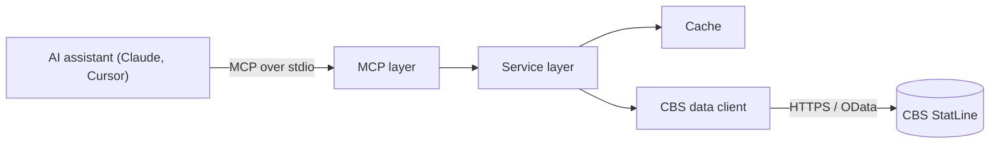

# nl-housing-mcp

An open source [MCP](https://modelcontextprotocol.io) server that gives AI assistants grounded access to official Dutch housing data from CBS (Statistics Netherlands).

> **Status: design phase (POC).** This repo currently contains the design and component documentation only. No code has been written yet. Everything marked "planned" is a plan, not a feature.

## The problem

The Netherlands has a severe housing shortage, and the official data about it is public but hard to use. CBS StatLine publishes thousands of tables with cryptic codes. A first-time buyer, an expat or a relocating candidate cannot easily ask: "Is Utrecht getting more expensive than Eindhoven, and how fast?"

## The idea

AI assistants are good at conversation but bad at facts. CBS is full of verified facts but bad at conversation. This server is the bridge: the assistant calls tools, the server fetches official numbers, and answers are grounded in real data instead of model memory.

This is **not a chatbot**. It is a small backend tool service that any MCP-compatible assistant can plug into.

## Planned tools

| Tool | Purpose |
|---|---|
| `get_price_trend` | Price index and year-on-year change for a municipality or region |
| `compare_regions` | Side-by-side price levels and trends for two regions |
| `get_market_headline` | Latest national figures in plain language |
| `list_datasets` / `explain_dataset` | Translate cryptic CBS table codes into readable labels |

## Architecture at a glance

See [docs/architecture.md](docs/architecture.md) for the full picture.

## Documentation

| Doc | What it covers |
|---|---|
| [docs/design.md](docs/design.md) | Requirements: scale, read/write mix, durability, latency, cost |
| [docs/architecture.md](docs/architecture.md) | Layers, data flow, failure handling |
| [docs/operations.md](docs/operations.md) | Logging, health check, Docker, CI |
| [docs/scaling.md](docs/scaling.md) | How this would grow beyond a POC |
| [docs/roadmap.md](docs/roadmap.md) | Build plan and open questions |
| [docs/decisions/](docs/decisions/) | Architecture decision records (ADRs) |

Component docs live next to the code they describe:

- [`src/nl_housing_mcp/server/`](src/nl_housing_mcp/server/README.md): MCP layer
- [`src/nl_housing_mcp/services/`](src/nl_housing_mcp/services/README.md): service layer
- [`src/nl_housing_mcp/clients/`](src/nl_housing_mcp/clients/README.md): CBS data client
- [`src/nl_housing_mcp/cache/`](src/nl_housing_mcp/cache/README.md): cache
- [`src/nl_housing_mcp/core/`](src/nl_housing_mcp/core/README.md): config, logging, errors, validation
- [`tests/`](tests/README.md): test strategy

## Constraints

- 100 percent free: no paid APIs, no API keys, no always-on hosting.
- Runs locally over stdio and is demoed with an MCP client such as Claude Desktop.
- Production-shaped structure, but honestly labelled as a POC.

## Licence

MIT. See [LICENSE](LICENSE).
