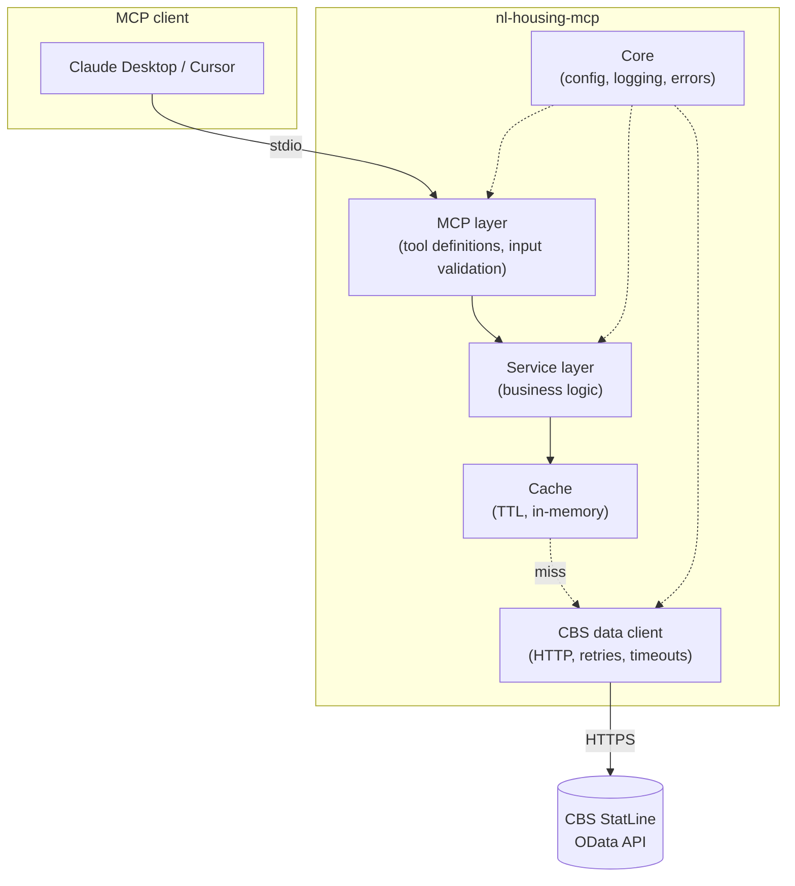
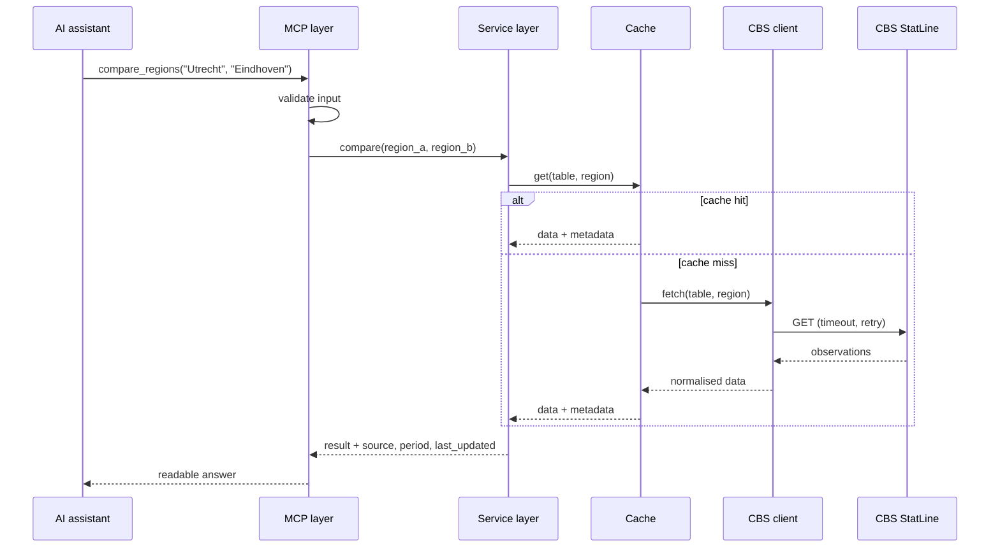

# Architecture

> Status: planned. Nothing here is implemented yet.

## Layers

## Responsibilities

| Layer | Owns | Must not |
|---|---|---|
| MCP layer | Tool names, schemas, input validation, turning errors into readable messages | Contain business logic or call CBS |
| Service layer | Comparisons, trends, plain-language summaries, response size limits | Know HTTP or OData details |
| Cache | TTL storage, stale-while-error behaviour | Decide what is business-correct |
| CBS data client | All knowledge of CBS: URLs, table IDs, field names, retries, timeouts | Leak CBS field names upward |
| Core | Settings, logging, shared error types | Depend on other layers |

Dependency direction is one-way: MCP layer, then services, then cache and client. Core is used by all.

## Request flow

## Trust rule

Every result includes the **source table ID, the period covered and the last-updated date**. If data is served from a stale cache because CBS failed, the response says so explicitly.

## Related

- [design.md](design.md): requirements behind these choices
- [decisions/](decisions/): why each major choice was made
